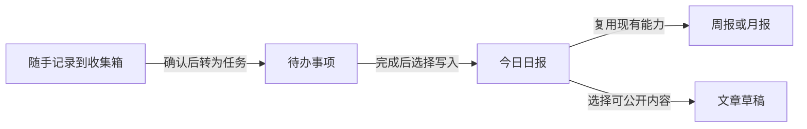

# 日常管理与记录效率优化评估

评估日期：2026-11-09。评估目标：优先提高项目所有者自己的日常管理、记录、查找和复盘效率。

同日后续背景补充：项目实际由超级管理员与几位注册用户共同使用，当前整体可用，本评估所列优化暂不急于实施。近期讨论转向站内意见反馈，具体参见 [意见反馈功能调研与方案](意见反馈功能调研与方案-2026-11-09.md)；下文优先级保留为原评估内部排序，不代表用户已确认的近期开发计划。

## 1. 结论与研究边界

项目已经具备个人工作系统的主要模块。当前收益最高的方向，是修复影响可靠性的具体问题，再打通「随手记录 → 安排任务 → 记录完成 → 生成复盘 → 沉淀文章」这条工作流程。

建议优先顺序：

1. 修复待办清单漏展示、切换清单内容错配、简历自动保存覆盖新输入。
2. 为备忘录、日报、周报补齐未保存保护和可恢复草稿。
3. 把现有工作台和新建入口升级为个人当天工作的入口。
4. 统一查找个人资料，减少在模块之间反复搜索。
5. 连接收集箱、待办、日报和周期复盘，减少重复录入。

本次完成了路由、布局、核心页面、API、服务、数据模型、测试和构建产物的静态审查，运行了现有测试、生产构建以及三个隔离复现实验。没有启动浏览器，没有连接生产数据库，没有修改业务实现。真实设备布局、线上网络耗时、生产数据规模和服务器现有定时任务未在本轮核验。

本文区分三类证据：

- **隔离复现**：使用临时 MongoDB 或提取现有函数、控制异步返回顺序验证；不等于完整 Vue 页面或浏览器回归。
- **代码确认**：可以从当前实现直接确认的行为或缺口。
- **产品建议**：针对个人效率目标提出的设计，需要通过实际任务耗时验证收益。

本文中的目标耗时是建议验收目标，不是现有实测结果。开发成本只用于排序，不能代替拆解后的估时。

## 2. 已有能力与应保留的基础

| 领域 | 当前能力 | 后续改进的起点 |
| --- | --- | --- |
| 文章阅读 | 目录、分类、标签、全文检索、阅读进度、最近阅读、继续阅读、前后文章 | 完善收藏找回与阅读后的记录动作 |
| 个人记录 | 收集箱、结构化资料、分类、标签、优先级、计划日期、敏感字段加密 | 降低记录步骤，增加草稿保护和转待办 |
| 待办 | 多清单、今天/全部/归档视图、事项优先级、快捷输入、完成统计 | 修复分页与异步问题，补齐跨日安排 |
| 工作日记 | 工作经历、日报、复制日报、定稿、历史版本、图片凭证、工时统计、回收站、导出 | 复用待办完成项，减少日报重复录入 |
| 周报/月报 | 已支持从日报生成独立 Markdown 草稿，保存和定稿 | 增加按成果/问题/计划汇总，以及来源变化提示 |
| 其他工具 | 个人导航、工具箱、账本、简历、题库、讨论 | 按个人使用频率组织入口，逐步接入统一查找 |
| 控制台 | 数据库菜单与 RBAC、多级折叠菜单、多标签、主题、全局新建入口、可定制快捷操作 | 复用骨架和权限，不另造一套导航 |
| 工程基础 | 前后端独立、模块化后端、权限测试、导入导出、受控发布与数据库备份流程 | 增加关键前端交互状态测试和数据恢复能力 |

工程体量已经较大：本轮扫描到前端 `src` 下 428 个 JS/Vue/CSS 文件，后端 `src` 下 290 个同类文件；后端有 29 个业务模块目录。继续增加独立功能前，应先提高已有功能的连贯性。

已有能力不应被当作缺失重新开发。例如全局新建入口、收集箱、快捷操作定制、阅读续读、日报版本和日报生成周报均已存在。

## 3. 第一批应修复的可靠性问题

### F01：清单超过一页后，部分清单无法从页面访问

**优先级：P0；证据：临时 MongoDB 复现；成本：S。**

后端 `listTodoLists()` 默认返回 30 张清单、最多 50 张，返回值包含 `total/page/pageSize`。前端 `loadLists()` 只请求状态并取 `result.items`，没有处理后续分页；「今天」又在这批结果上进行客户端筛选。

隔离实验创建 35 张旧日期的未归档清单和 1 张当日清单。默认接口返回 `total=36`、`items.length=30`，今日清单不在返回数据中；显式请求第二页可以找到它。因此页面可能显示今天没有清单，而数据库实际存在今日清单。

代码位置：

- `frontend/src/views/console/TodoPage/index.vue:292`：从当前已加载列表筛选今日数据。
- `frontend/src/views/console/TodoPage/index.vue:327`：未传分页、未处理 `total`。
- `backend/src/modules/todo/services/todo.service.js:77`：默认分页及排序。

建议：将今日范围交给服务端筛选，统一业务日期边界；全部与归档清单提供分页或加载更多，保留选中的清单和详情。不能仅把 `pageSize` 增大为另一个固定上限。

验收：分别建立 0、1、30、31、100 张清单；今日清单无论排序位置如何均可访问；新建和修改日期后可以定位到目标清单；无日期清单也有明确入口。

### F02：快速切换清单时，旧请求可以覆盖当前内容

**优先级：P0；证据：现有函数的异步乱序复现；成本：S。**

`selectList()` 立即改变选中 ID，随后调用 `loadSelectedList()`。详情请求返回后直接赋值 `items`，没有检查当前选择或请求版本。

隔离实验调用现有函数：先选择 A，再选择 B，让 B 先返回、A 后返回。最终 `selectedListId=B`，展示数据为 `item-A`。后端对事项所属清单有检查，当前证据支持界面错配和操作失败，不据此推断可以跨清单修改数据。

代码位置：`frontend/src/views/console/TodoPage/index.vue:337`、`:361`。

建议：为详情加载增加请求序号和清单 ID 检查；切换中显示对应的加载态并禁止对旧详情提交操作；刷新、完成操作后的回填同样检查目标上下文。文章列表和备忘录编辑加载已经采用请求版本检查，可参照其方式。

验收：A→B→A 快速切换、网络请求乱序和失败重试时，标题、事项、统计与操作目标始终属于同一清单。

### F03：简历自动保存响应可能覆盖保存期间的新输入

**优先级：P0；证据：现有函数的隔离复现；成本：M。**

简历编辑器已实现 1 秒防抖自动保存。但 `saveNow()` 收到响应后会无条件执行 `applyResume(saved)`，后者重新赋值整个编辑对象。请求发出后继续输入的内容可能被旧快照覆盖，界面仍显示「已保存」。

隔离实验使用现有 `saveNow()` 和 `applyResume()`：开始保存标题「saved snapshot」，请求未返回时把标题改为新内容，再返回旧快照。最终标题回到旧值，保存状态为 `saved`。

代码位置：`frontend/src/views/console/ResumePage/ResumeEditor.vue:201`、`:227`、`:279`。

建议：引入编辑版本和保存版本；保存响应只确认对应版本，不覆盖此后产生的输入；请求串行合并，保留最新待保存快照。切换简历、关闭编辑页和请求失败时也要处理未完成保存。跨标签或跨设备编辑可进一步使用服务端版本冲突检查。

验收：慢网连续输入、保存期间切换简历、连续触发保存、请求失败后重试；最新输入不被旧响应覆盖，「已保存」只对应当前编辑版本。

### F04：备忘录、日报、周报的未保存保护不一致

**优先级：P0；证据：代码确认；成本：M。**

文章编辑器已通过 `useUnsavedChanges()` 提供离开确认；工作日记已有已保存版本历史。这些机制不能保护尚未提交的弹窗内容。

备忘录关闭事件直接交给父组件，再次打开会 `resetForm()`；日报 `close()` 直接关闭，再次打开会 `populateForm()`；周报关闭也直接修改可见状态。没有发现这些编辑器在关闭时检查未保存内容或提供恢复草稿。

代码位置：

- `frontend/src/views/console/MemoPage/MemoRecordEditor.vue:12`、`:226`。
- `frontend/src/views/console/WorkJournalPage/WorkLogEditorModal.vue:137`、`:181`。
- `frontend/src/views/console/WorkJournalPage/WorkReportEditorModal.vue:9`、`:63`。
- 对照：`frontend/src/composables/useAdminUi.js:77`、`frontend/src/views/admin/AdminArticleEditor/index.vue:460`。

建议分两步：先为关闭、Esc、遮罩、路由离开和标签关闭补齐一致的未保存确认，再增加按「用户 + 模块 + 记录 ID」隔离的恢复草稿。保存失败保留输入，并允许重试。

草稿必须尊重数据边界：密码、证件号、敏感资料字段不能直接落入浏览器明文持久存储；文章自动保存不能顺带把已发布文章改成草稿；日报自动暂存不能自动定稿。不同内容类型采用明确的暂存策略。

验收：每类编辑器输入后执行取消、Esc、遮罩关闭、刷新、切换页面；返回后能够选择恢复，成功保存后清理对应暂存内容。

## 4. 最能提高日常效率的产品改进

### F05：用现有工作台承接「我今天要做什么」

**优先级：P1；证据：代码确认 + 产品建议；成本：M。**

管理员现有首页主要显示文章、用户、评论、媒体等运营统计。其「待办事项」包含全部媒体文件数量，并将其计入 `totalPending`，媒体存量不等于待处理工作。个人待办、计划到期的记录和当天日报没有在此汇总。普通用户访问 `/console` 会转到文章列表。

代码位置：`frontend/src/views/admin/AdminStats/PcView.vue:432`；`frontend/src/router/index.js:611`。

建议在现有工作台中提供「我的工作 / 站点运营」视图或可选默认视图，以当前用户为范围集中展示：今日和逾期任务、未处理收集箱、今日日报是否已写、最近编辑的草稿、继续阅读。快捷入口沿用已有可定制能力。

继续保留顶部一级菜单、左侧折叠结构和数据库 RBAC；个人区只聚合本人有权访问的数据。媒体数量保留为资产统计，不计为待处理数量。

验收：登录后无需逐个进入模块即可确认当天重点；从工作台直接打开对应清单、草稿和日报，不要求重新筛选日期或公司。

### F06：完善已有新建入口，让随手记录保持在当前工作上下文

**优先级：P1；证据：代码确认 + 产品建议；成本：M。**

顶部已经有新建内容入口，备忘录支持 `?create=1`，记录编辑器支持正文生成标题和 Ctrl/Cmd+Enter。待办入口却只跳到 `/console/todos`，并不直接打开新建或聚焦快速添加；全局入口未包含写日报、快速记账。手机入口需要先打开更多菜单。

代码位置：`frontend/src/views/console/ConsoleLayout/index.vue:618`、`:944`；`frontend/src/views/console/TodoPage/index.vue:519`；`frontend/src/views/console/MemoPage/MemoRecordEditor.vue:21`。

建议：复用现有入口，支持当前页面上直接打开的轻量记录框；首屏以内容为主，分类、标签、优先级放到展开区。增加可配置快捷键、直接添加事项和写今日日报入口；记账按实际使用频率接入。表单默认值可记住上次公司/清单，但必须允许明确切换。

快捷入口继续按现有权限过滤。快捷键不得抢占输入法组合输入和文本编辑器操作。

验收建议：在已经登录的任意常用页面，以不超过 2 个入口动作开始记录；简单想法从打开到保存目标 15 秒以内。保存后能继续当前文章或工作页面。

### F07：把文章搜索扩展为有权限边界的统一查找

**优先级：P1；证据：代码确认 + 产品建议；成本：L。**

当前全文检索只查已发布文章。个人记录、工作日报、周期报告、个人导航以及管理员自己的文章草稿需要分别进入模块查找。这使用户必须先记住内容存在哪个模块。

代码位置：`frontend/src/views/public/SearchPage/index.vue:5`；`backend/src/modules/search/services/search.service.js:470`，其基础条件固定为 `status=PUBLISHED`。

建议保留现有文章检索，增加控制台专属的统一入口，先接入文章、个人记录、日报/周报和书签。结果按类型展示，并携带日期、来源和可以直接定位的链接。后续再按需要接入媒体名称和账本。

服务端必须分别检查菜单权限、文章管理权限和记录所有者，不能只依赖前端过滤。敏感加密字段、密码箱内容不进入通用检索。不要先全库取出再在浏览器混合过滤。

实现可先复用各模块查询服务，限制每类返回量；数据规模和检索基准证明现有方案不足后，再决定是否引入独立搜索引擎。

验收：准备 20 条已知目标分布在至少 4 个模块中，按关键词查找时不需要预先进入模块；权限不足的类型不返回标题、摘要或数量等信息。

### F08：连接收集箱、待办、日报和文章，减少同一件事反复填写

**优先级：P1；证据：模型与服务确认 + 产品建议；成本：L，可分步交付。**

目前收集箱有计划、状态、优先级，待办也有完成状态和优先级，日报还有今日完成/后续计划；相关模型与当前流程中未发现贯通三者的来源关联。

建议先实现两个高频动作：「记录转待办」「已完成待办选入今日日报」。保留原记录与来源链接，对重复转换去重；用户确认后再写入目标，源内容不自动删除。随后增加日报后续计划转待办、记录整理为文章草稿。

跨模块转换需要检查两端权限和数据归属；日报转换文章时，默认排除私人工作材料、凭证、密码等内容。完成待办不能自动推算工作时长。

验收：一个工作问题从记录到完成、再到日报，只需写一份主体内容；目标记录可追溯到来源；重复点击不生成重复事项。

### F09：为日期、跨日任务和周期复盘补齐可执行视图

**优先级：P1；证据：代码确认 + 产品建议；成本：M，复杂重复规则另计。**

待办目前按清单记录 `planDate`，事项自身只有完成、说明和优先级；「今天」只匹配当天日期，未完成旧清单需要回到全部列表查找。备忘录有 `dueAt` 和即将到期统计接口，但当前记录页没有日期筛选，且统计接口未被页面使用。

建议先提供「逾期未完成 / 今天 / 未来 / 无日期」视图，明确清单日期与事项截止时间的语义；允许选择性顺延，保留原计划信息。日报入口可按工作经历提示漏写日期。周/月复盘用可见摘要或用户选定时间提醒，优先避免打断式弹窗。

业务日期统一处理。当前待办使用服务端本地日边界、前端本地日期比较，部分记录使用 UTC 字符串截断；跨时区和午夜边界应纳入验证。

通知偏好目前在用户模型、资料读写和序列化中出现，未发现业务发送端消费这些设置的引用。不能据此把现有「邮件通知」开关视作已经完成的待办提醒能力。若增加提醒，应同时实现发送、去重、失败处理与偏好生效。

验收：昨天未完成的任务有稳定入口；当天任务在午夜、手机和电脑上归属一致；提醒不重复；关闭某类通知后确实停止该类提醒。

### F10：改进已有周报生成，让复盘更少整理

**优先级：P1；证据：代码确认 + 产品建议；成本：M。**

现有 `renderWorkReport()` 会计算工时，并把各日日报按日期拼成 Markdown。报告保存 `sourceLogIds`，但之后内容独立，且同一工作经历、周期不允许重复生成。新增或修改日报后，需要人工判断已保存报告是否过时。

代码位置：`backend/src/modules/workJournal/services/workJournal.service.js:635`、`:703`；`backend/src/modules/workJournal/models/WorkReport.js:14`。

建议增加按「本周成果 / 阻塞风险 / 下周计划」组织的规则模板；将原始日明细保留在附录。记录来源版本或生成时间，提示来源日报发生变化，并让用户预览差异、选择更新草稿，保留人工补充内容。

验收建议：完成日报后，周报初稿无需再次复制正文；目标 3 分钟内完成检查和调整。修改日报后可识别受影响报告；已定稿报告不会被后台自动覆盖。

### F11：补齐文章收藏的集中找回入口

**优先级：P2；证据：代码确认 + 产品建议；成本：M。**

文章详情可以收藏，后端有收藏与取消接口，已有阅读历史；未发现对应「我的文章收藏」列表路由及读取收藏列表的接口。个人导航中的书签和工具箱收藏属于其他对象，不能代替文章收藏。

建议增加文章收藏/稍后读列表，支持标签或分组、失效文章提示、直接继续阅读。先提供集中找回，再评估文章划线批注等更复杂能力。

代码位置：`backend/src/modules/interaction/routes/interaction.routes.js:29`；`frontend/src/services/interaction.js:23`；`frontend/src/router/index.js`。

### F12：为高价值个人数据提供恢复和按需导出

**优先级：P1 至 P2，视是否存放唯一副本而定；证据：代码确认 + 运维待核验；成本：M。**

文章、媒体、日报已有回收或恢复机制，书签和日报已有导出；备忘录删除使用 `deleteOne()`，待办删除清单和事项使用物理删除，未发现其业务级恢复和导出入口。

代码位置：`backend/src/modules/memo/services/memo.service.js:319`；`backend/src/modules/todo/services/todo.service.js:141`、`:182`。

建议先为备忘录与待办补齐软删除和恢复，再提供 JSON/CSV 等适合当前对象的导出；支持导出范围选择并保留关联 ID。撤销入口只有在服务端可以可靠恢复后才有实际意义。

当前发布脚本已有数据库备份，这与日常自动备份、异机副本及恢复演练不同。代码仓库不足以确认服务器是否另有计划任务，实施前先盘点现状，再补齐需要的部分。恢复应覆盖 MongoDB、上传文件及必要密钥配置；整库回滚不能替代单条误删恢复。

敏感字段导出必须明确策略，不能默认解密后混入普通文件。`output` 继续作为文章源仓库，不把个人记录直接并入公开文章同步流程。

## 5. 性能与工程方面的支持性优化

### F13：优先减少首屏阻塞和高频操作的重复请求

**优先级：P1；证据：构建测量 + 代码确认；成本：分项 S/M。**

本次生产构建成功，但报告存在超过 500 kB 的 chunk。`antd-vendor` 约 1,618 kB，Vite 报告 gzip 约 485 kB；`index.html` 已直接预加载它，属于首屏依赖。账本图表、Excel、Mermaid 等大文件应按各自页面的加载链路评估，不能把全部构建体积当作首页下载量。

`frontend/src/main.js:50` 在会话恢复和站点资料请求均完成后才挂载应用；普通请求超时为 30 秒。站点资料慢或失败会推迟首屏挂载。已有缓存可以用于尽早显示骨架和主题，再后台更新配置；控制台受保护内容仍必须等待认证确认。

待办每次添加、勾选或删除事项后都会 `refreshAll()`，重新请求清单列表和详情。建议使用写接口返回值更新对应事项及计数，必要时后台校准；失败回滚，并为当前对象设置操作中状态。

代码位置：`frontend/src/views/console/TodoPage/index.vue:461`、`:475`；`frontend/src/main.js:31`、`:50`。

检索服务同时执行全文检索和正文正则补充，再加载全部候选文章、应用层评分排序，最后切片分页；搜索建议也是先取全部匹配项再截断。数据规模扩大后可能放大数据库与内存成本，但本轮没有线上压测，不能直接声称当前查询已很慢。

代码位置：`backend/src/modules/search/services/search.service.js:552`、`:571`、`:617`。

建议先记录实际 p50/p95、候选数量和响应体积，建立有代表性的检索词集，再优化字段投影、可复用检索文本、索引及合理候选策略。限制候选数时必须验证中文召回、排序、分面和总数，不能静默漏结果。

### F14：让交互状态测试覆盖真实的高频风险

**优先级：P1；证据：测试目录与本轮复现；成本：随相关修复交付。**

前端现有测试主要覆盖工具函数、Pinia 和部分媒体组合逻辑，未发现待办页面异步切换、编辑弹窗草稿保护、简历保存版本管理的对应测试。本轮证明，现有测试通过仍可能存在这些状态问题。

优先增加有业务意义的用例：分页与今日过滤、乱序响应、保存中继续输入、切换记录、失败保留输入、跨日范围、跨模块权限。简单文字样式不增加机械测试。浏览器验证继续遵守项目规则，只在获得明确授权后用于这些问题所需的最小页面和交互。

存在超过 1,200 行的媒体、文章编辑器、个人信息、控制台布局等组件。后续新增草稿管理、快速创建和个人工作区时，应抽离有独立状态的新增职责；不要为了这次研究顺带重写整个布局或公共表格。

## 6. 建议实施顺序与依赖

成本口径：S 约 0.5–1.5 个开发日，M 约 2–4 个开发日，L 约 5–8 个开发日；按熟悉项目的单人开发粗估，包含相关测试，跨模块范围确定后重新估算。各项存在复用和重叠，不能机械相加。

| 阶段 | 交付范围 | 用户可感知的结果 | 依赖 |
| --- | --- | --- | --- |
| A：先可靠 | F01–F03；F04 先补关闭确认 | 清单不漏、内容不错配、输入不被旧响应覆盖、误关不直接丢内容 | 先补关键回归用例 |
| B：记录更快 | F04 恢复草稿；F05 个人当天工作区；F06 完善新建 | 打开后知道做什么，记录时少跳页 | 延用菜单/RBAC、缓存和现有弹窗能力 |
| C：查找与复用 | F07 首批四类统一查找；F08 记录转待办、完成项入日报 | 不必先记住存放模块，同一事项少录入几遍 | 所有者与两端权限、深链接、幂等来源关系 |
| D：长期积累 | F09 跨日安排；F10 周期复盘；F11 收藏；F12 恢复与导出 | 昨日任务不遗漏，复盘和资料找回更稳定 | 根据实际使用频率决定先后 |
| 持续治理 | F13 与 F14 随相关任务实施 | 等待更少，后续调整更不容易破坏已用流程 | 实测基线，按当前模块限定范围 |

最适合先开工的一组：**待办分页与乱序修复 + 简历保存版本修复 + 三类记录编辑器的未保存确认**。这组变更范围清楚，能够先提高日常使用的可信度。

涉及模型、枚举、索引或权限种子时，按项目数据库迁移规则另行判断。新脚本默认 dry-run，已有备份后才执行 apply；不能用整库覆盖来同步这些优化。实现阶段维护当天项目记录，本次研究文档本身不代表功能已交付。

## 7. 如何判断优化是否提高了自己的使用效率

个人使用场景以任务完成质量和耗时为主，访问量与页面点击次数不足以代表收益。先用一周实际操作建立基线，再在相同任务上比较；少量本地计时即可起步，不必先建设完整埋点平台。

| 指标 | 建议测法 | 初始验收方向 |
| --- | --- | --- |
| 随手记录耗时 | 从任意常用页开始，到一条简单记录保存成功 | 目标 15 秒内；观察中位数与最慢情况 |
| 找回资料耗时 | 20 条预先选定的文章/记录/日报/书签，按真实关键词查找 | 目标多数在 20 秒内找到，记录失败项 |
| 日报整理耗时 | 使用当天已完成待办组织日报 | 对比原来的总耗时与重复输入次数 |
| 周报整理耗时 | 已有完整日报后生成并确认一篇周报 | 目标 3 分钟内完成初稿检查；按内容复杂度修正 |
| 编辑可靠性 | 慢网、关闭、刷新、切换记录、保存失败与重试 | 已确认场景中未保存输入不被静默覆盖或丢弃 |
| 数据可达性 | 大量清单、跨日任务、归档记录和收藏资料 | 有明确入口，分页不让内容消失 |
| 持续使用 | 每周实际完成记录/任务/复盘的天数 | 观察是否更稳定地使用，而非仅增加打开次数 |

如后续增加统计，只收集耗时、成功与失败、来源类型等必要信息，不采集正文、证件号、密码或搜索到的私人内容。

## 8. 后置事项与本轮验证结果

访客点击首页文章后先进入登录，是当前路由确认的行为；公开阅读、搜索引擎收录、注册回跳和自助找回账号属于访客增长方向。它们可以单独立项，但在本次个人效率目标下排在记录可靠性、统一查找和流程复用之后。是否开放匿名阅读还涉及产品定位，应独立决定。

暂不优先投入大型 AI 助手、复杂推荐、积分签到、装饰性大改版、完整项目管理系统或原生 App。周报已有规则生成能力，先改进模板与来源衔接；AI 适合作为后续可选整理能力，并明确私人数据的处理范围。

本轮验证：

- `frontend/npm run build`：通过；存在大 chunk 提示，具体体积见 F13。
- `frontend/npm run test`：29 个测试文件、130 项测试通过。
- `backend/npm run test -- --reporter=verbose`：56 个测试文件、366 项测试通过，耗时约 327 秒。首次默认运行退出码为 1 且没有有效失败详情，随后完整重跑通过；首次异常原因未确认。
- 独立 `health.test.js`：1 项通过，属于排查首次测试异常时的额外验证，已包含在全量数量中。
- 临时 MongoDB 验证待办分页漏展示；未使用现有业务数据库。
- Node VM 调用现有函数，复现待办乱序响应和简历旧保存响应覆盖新输入；没有执行浏览器或真实 DOM 交互。
- `pwsh -File scripts/check-encoding.ps1`：通过；新增报告和文档索引另行确认可按 UTF-8 解码，文件头无 BOM。
- `git diff --check`：通过；报告中的源码路径与行号已核对存在。
- 本次只新增研究报告并维护文档索引；上述优化均为待实施事项。
