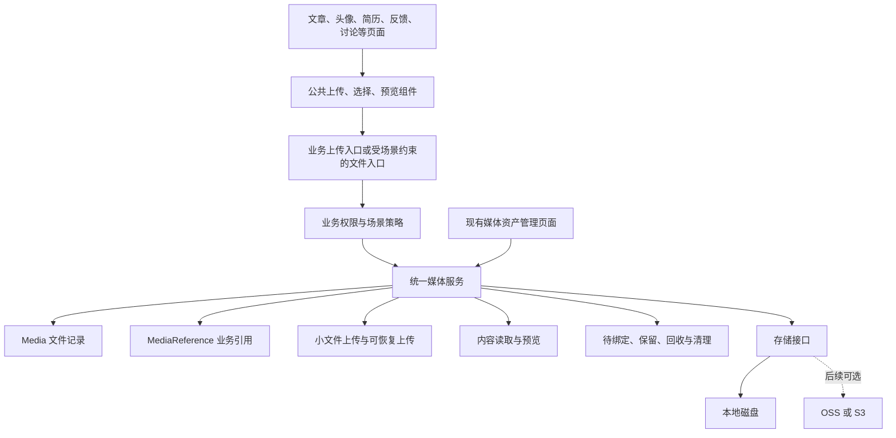

# 文件资源上传管理现状审计与统一方案

调研日期：2026-11-10。本文保留调研时的源码快照、官方资料和设计建议。后续已实施的能力与使用方式参见 [统一文件资源接入与维护](统一文件资源接入与维护.md)，本文中的“当前”均指调研时状态。

## 1. 结论与建议

当前项目已经有相当完整的媒体资产模块，但它主要服务于后台媒体管理，尚未成为所有业务共同使用的文件基础能力。新增页面仍容易再写一套上传接口、目录、格式校验和清理逻辑，这正是当前分散的主要原因。

建议在现有 Express 应用的 `media` 模块内渐进建设统一能力：

> 文件由媒体模块统一登记、存储和管理生命周期；业务模块通过文件 ID 使用文件，并负责声明业务权限和引用关系；页面复用上传、选择和预览组件。

这里的“统一”包含存储、元数据、校验、传输、访问、引用、清理和运维。不同业务继续保留不同格式、数量、保留期限和访问权限。例如，简历导出仍可要求照片为 JPG，反馈截图仍受反馈处理权限限制，密码箱仍需要额外解锁。

本项目适合先保留本地磁盘，实现清晰的模块边界。接入 OSS/S3 或独立文件服务属于后续扩展，不能替代文件登记、权限和引用管理。

## 2. 调研范围和证据边界

本次阅读了应用入口、媒体模型、普通上传和分片上传、文件访问和删除、引用扫描、库存扫描、头像、简历、讨论、工作日志、反馈、文章文档导入、前端传输状态及相关测试和发布脚本。

同时通过 Context7 搜索官方文档，并通过 HTTP 读取官方站点和 GitHub 官方仓库。参考系统包括 Directus、Strapi、Drupal、Rails Active Storage、RuoYi-Vue-Plus；文件校验和对象存储访问参考 OWASP、AWS 官方资料。来源见第 12 节。

本次没有访问生产服务器、数据库和实际库存，没有启动浏览器，也没有执行上传、删除、迁移或部署。因此，本文能确认源码中的实现和缺口，不能给出线上文件数量、实际泄露范围或历史孤儿文件数量。涉及线上 Nginx 直出、备份覆盖和历史访问的判断，需要实施时另行核验。

## 3. 当前项目上传链路盘点

| 场景 | 当前上传和保存方式 | 是否登记 Media | 引用与清理现状 |
| --- | --- | --- | --- |
| 后台媒体资产 | multipart 临时落盘后入库；另有 2MB 分片、24 小时上传会话 | 是 | 分类、权限、回收站、引用检查、缩略图和下载较完整 |
| 文章封面 | 编辑页调用 `uploadAdminMedia` | 是 | 封面字段保存 URL，引用主要靠 URL 反查 |
| 文章正文图片 | 编辑页调用普通上传，先归入“文章正文临时图片” | 是 | 保存文章后通过解析 Markdown/HTML 地址晋升分类及绑定主文章；多文章复用仍依赖扫描 |
| 文章附件、原始文档与阅读版 | 选择媒体，或导入原始文档并生成阅读版 | 是 | 部分字段已有 mediaId；导入流程仍有专属落盘和补偿清理 |
| 用户头像 | profile 路由自建 Multer，存入 `uploads/avatars` | 上传链路未登记 | 用户字段保存 URL；删除只清空引用，历史文件由库存工具辅助处理 |
| 简历照片 | resumePhoto 服务自建 Multer，存入 `uploads/resumes` | 上传链路未登记 | 简历保存 photoUrl；更新后直接删除原专属目录照片 |
| 讨论图片、附件 | discussion 路由自建 Multer，存入 `uploads/discussions/年月` | 上传链路未登记 | 客户端把附件对象随消息提交；清理服务直接删除附件 storagePath |
| 工作日志图片凭证 | 业务路由接收文件，业务服务校验、写盘、创建 Media | 是 | Media 与日志互存业务关联，专属鉴权读取和清理；保留历史目录兼容 |
| 意见反馈截图 | 随业务提交，服务使用 Sharp 校验、写盘、创建私有 Media | 是 | 专属反馈鉴权读取；Media.feedback 标记业务引用，失败补偿回收 |
| 书签、账本、台账等导入文件 | 多为内存接收后解析 | 不必登记为长期资产 | 属于临时处理输入，应统一传输限制和临时清理，不必成为可复用素材 |

需要区分“没有在上传时登记”和“永远不存在 Media 记录”。库存补录可以把部分历史文件登记进去，但它不能让原上传流程自动变成统一链路。

### 3.1 已有能力值得保留

- `Media` 已具备文件基本信息、上传人、分类、`public/private/vault`、软删除和可选 SHA-256 字段。
- 媒体中心已有全局上传队列、进度、暂停、重试、切换页面继续传输和账号切换清理。
- 分片上传具备服务器偏移恢复、可选分片校验、固定资源 ID 和完成请求幂等。
- 已有并发和磁盘空间保护、临时上传过期清理、缩略图缓存、批量下载和分享管理。
- 删除前已经检查已知业务引用和有效资源分享；工作日志、反馈已有真实文件校验或内容校验的基础。
- 库存扫描已经保护简历、讨论、反馈和密码箱等特殊目录，避免把这些文件直接当普通孤儿文件删除。

这些能力说明改造应以收敛复用为主。当前问题不能简单归因于“没有媒体库”。

### 3.2 造成维护困难的具体原因

1. **存储、登记和业务绑定分散。** 各模块自行决定目录、文件名、文件写入、Media 创建和失败补偿。
2. **通用能力绑定后台权限。** 分片上传路由要求登录、管理员身份和媒体菜单权限。普通用户上传头像、反馈截图不适合直接调用此后台接口；应共用底层服务，由业务入口执行对应授权。
3. **前端复用不完整。** 媒体中心使用分片队列，文章编辑器调用普通上传，头像和简历再用专属接口。文章资源选择器、资源预览还在 1618 行的编辑页内部，新增页面容易继续复制。
4. **分类同时承担多种职责。** 当前分类既表达业务用途，又参与临时图片晋升和密码箱访问模式。新增业务后，分类名称容易被误当成生命周期或权限依据。
5. **资源模型不断增加业务字段。** Media 已有 article、workJournalLog、workJournalEvidence、feedback。继续增加业务会让通用媒体模块认识越来越多领域。
6. **引用主要靠逆向扫描。** mediaReference 服务直接查询文章、用户、设置、日志等集合，解析 URL 或按特定字段匹配。新增模块未接入扫描时，“没有扫描到”不能证明没有引用。
7. **URL 同时承担身份和访问地址。** 更换域名、对象存储、私有访问接口或路径后，可能影响引用识别；现有代码中也存在通过字符串寻找 `uploads/` 来构造 URL 的实现。

## 4. 应优先处理的实际问题

### 4.1 讨论附件由客户端提供磁盘路径

源码链路：

- [discussion.validator.js](../../backend/src/modules/discussion/validators/discussion.validator.js) 接收 `attachment.storagePath`，仅校验字符串长度。
- [discussion.service.js](../../backend/src/modules/discussion/services/discussion.service.js) 把客户端 attachment 直接保存到消息。
- [discussionCleanup.service.js](../../backend/src/modules/discussion/services/discussionCleanup.service.js) 直接执行 `fs.unlink(attachment.storagePath)`，没有限定附件根目录或核对服务端上传登记。

因此，在获得讨论访问权限且属于相应会话的前提下，提交伪造附件记录后触发撤销或清理，存在让服务器尝试删除客户端指定路径的风险；实际成功与服务进程的文件权限、路径存在性有关。业务成员鉴权不能证明路径属于该成员上传的附件。

优先修复方向：客户端只提交上传返回的 mediaId 或不可伪造的上传凭据；服务端查询上传人、所属会话和状态，再建立引用。所有物理删除只能从服务端文件记录解析路径，并验证真实路径落在允许的存储根目录内。历史附件应有严格的目录保护，不能继续信任消息中携带的路径。

这项修复应独立于完整架构改造先完成。

### 4.2 讨论和简历文件读取绕过业务授权

[app.js](../../backend/src/app.js) 对工作日志、反馈、密码箱历史目录和缩略图做了拒绝静态访问处理，随后把 `/uploads` 整体挂载为静态目录。讨论和简历上传地址位于其下，当前应用源码中没有相应的静态访问拦截。

这意味着拿到 URL 的请求可以直接读取这些文件，不会经过讨论成员或简历所有者校验；上传时校验身份不等于读取时仍受保护。是否存在额外线上 Nginx 限制需要核验，但应用自身目前没有提供这层保护。

建议讨论附件、简历证件照默认采用私有业务访问策略。切换读取接口时要同步适配前端图片展示、历史消息、简历复制和 PDF/Word 导出，不能只改存储目录。

### 4.3 不同入口的真实类型校验不一致

头像和简历主要检查客户端 MIME，普通媒体上传主要检查后缀；反馈图片则使用 Sharp 读取元信息并尝试解码，工作日志也校验真实格式及匹配关系。客户端 MIME、扩展名都不能单独证明文件真实类型。

此外，普通媒体支持 SVG、HTML、脚本、安装包等多种格式。此类“可存储文件”不应自动获得同源内联展示权限。下载、图片预览、文本预览需要不同的响应策略。

建议统一提供基础校验器和按场景的真实内容校验。普通栅格图片使用解码校验；SVG 按需禁用或经过专用净化；HTML、脚本等默认附件下载或转义为文本，不能直接作为可信页面执行。参考 [S7]。

### 4.4 私有存储统计与备份目录未完全统一

密码箱当前使用上传根目录旁的 `uploads-private/vault`；新工作日志图片位于 `uploads/work-journal`，历史工作日志还兼容 `work-journal-private`。

- `mediaStorage.service.js` 统计 uploads、uploads-private 和 .media-tmp，没有统计历史 work-journal-private。
- `deploy-release.ps1` 的运行数据备份段处理 uploads 和 work-journal-private，没有看到 uploads-private 的对应备份。

这是仓库中该发布脚本的覆盖缺口，不能据此判断服务器是否存在其他独立备份。统一方案应让存储根目录、容量统计、备份和恢复共用同一份目录清单；临时会话目录可以按可重建数据处理，但永久私有文件必须有明确备份和恢复验证。

### 4.5 进入回收站不等于撤销公开链接

当前 deleteMedia 主要设置 deletedAt/deletedBy，原文件仍保留在磁盘；公开静态文件请求也不会查询 Media.deletedAt。因此，进入媒体回收站的公开文件，原 URL 在文件实际删除前仍可能被直接读取。

这需要明确产品语义：如果回收站只表示从管理列表中移除，可以保留该行为并如实提示；如果要求回收时停止访问，就必须让读取检查资源状态，或把原文件转移到不再公开的存储区域，并处理缓存。不能仅通过数据库软删除实现公开链接撤销。

## 5. 成熟系统提供了哪些可借鉴模式

| 系统 | 官方文档或源码中的做法 | 对本项目的启发 |
| --- | --- | --- |
| Directus | 文件和文件夹有统一记录；通过文件 UUID 访问 `/assets/:id`；文件权限约束元数据与内容；存储采用 adapter | 业务保存稳定 ID，访问由统一入口授权；存储原始目录不直接承担权限。见 [S1] |
| Strapi | Media Library 集中管理素材，Upload 包负责后端上传，provider 支持本地、S3、Cloudinary 等，支持私有 provider | 媒体管理页面、上传服务和物理存储应各有清晰职责。见 [S2] |
| Drupal | Media 是可复用内容实体，业务通过 Media reference 字段关联；Media Library 支持查找和选择；File Usage 服务按模块、实体类型和实体 ID 记录用途 | 引用应成为结构化数据，不能长期依赖扫描各业务 URL。见 [S3] |
| Rails Active Storage | blob 保存文件元信息，attachment 作为业务对象与文件之间的多态关联，variant 单独记录衍生文件；支持本地和云端服务 | 文件与业务关联分离，支持一份文件多处使用，以及缩略图、预览版的派生关系。见 [S4] |
| RuoYi-Vue-Plus | SysOssController 统一上传、按 ID 下载和删除；SysOss 保存对象记录与存储服务；OssClient 抽象上传、读取、删除和预签名 | 企业管理系统同样把文件当作统一系统能力，业务使用文件 ID，存储提供方可以替换。见 [S5] |

这些系统不是同一套实现，也没有证明“采用其中一个框架就自动拥有完整生命周期”。例如，抽查的 RuoYi-Vue-Plus 删除校验处仍有业务校验占位；Rails 文档明确提醒默认文件控制器公开可访问，私有文件需要自行实现认证控制器。需要借鉴架构边界，再结合本项目落实权限和引用规则。

共同模式可以归纳为：统一文件记录、统一存储接口、明确业务关联、可复用操作组件，以及服务端执行的访问策略。

## 6. 推荐架构

### 6.1 逻辑结构



保留现有 `media` 模块名称和媒体资产入口即可。统一资源能力属于后端模块职责，不要求单独部署微服务，也不要求调整控制台导航。

业务可以继续有 `/profile/avatar`、`/feedback`、`/work-journal/.../evidence` 等入口。判断是否统一的标准是它们是否调用相同的文件基础服务，而不是 URL 是否全部相同。

### 6.2 各层职责

| 层次 | 应负责 | 不应让每个页面重复处理的内容 |
| --- | --- | --- |
| 页面及公共组件 | 选择、拖拽、粘贴、裁剪、预览、进度、移除待选项 | 文件路径、存储目录、永久删除判断 |
| 业务服务 | 当前用户能否操作业务对象、字段限制、业务保留和分享规则 | 自建落盘目录、直接 unlink、手写 URL 拼接 |
| 文件场景策略 | 类型、大小、数量、访问方式、复用范围、上传后是否待绑定 | 依赖用户随意填写 accessScope 或目录名 |
| 媒体核心服务 | 文件登记、绑定与解绑、状态、幂等、访问分发、清理 | 在一个大函数中不断 if/else 判断所有业务 |
| 存储接口 | 写入、读取流、删除、stat，以及可选预签名能力 | 文章、反馈、简历等领域规则 |
| 媒体管理页 | 根据权限盘点、筛选、查看引用、处理回收和库存差异 | 作为所有用户上传所必经的后台页面 |

新增服务放在 `backend/src/modules/media/services`，按校验、存储、引用和生命周期拆分明确职责。当前 media.service.js 为 935 行、admin.routes.js 为 925 行，不宜把新增独立职责继续集中叠加进去。

### 6.3 建议的数据结构

第一阶段继续复用 Media，不必同时引入 File、Asset、Blob 等多套相似模型。建议渐进补充：

| 字段或概念 | 用途 |
| --- | --- |
| id | 稳定的业务引用标识，沿用当前 MongoDB ID 即可 |
| provider / storageKey | 存储提供方及相对对象键，逐步替代对服务器绝对路径的依赖 |
| originalName / mimeType / size / hash | 原始名称、服务端确认的真实类型、大小及按需校验值 |
| uploader / scene | 上传人和来源场景；scene 表示来源，不替代全部引用关系 |
| accessScope / accessPolicy | 公开、私有、密码箱，以及私有文件所属的授权策略 |
| lifecycleStatus / expiresAt | 待绑定、保留、回收等状态和临时保留期限 |
| categoryId | 人工整理、查找用途，和业务类型、文件类型、生命周期分开 |
| parentMediaId / variantKey | 按需描述缩略图、阅读版等衍生资源 |

旧 url/storagePath 字段可以在过渡期保留；新业务应以 ID 为主，URL 是读取时返回的展示信息。业务数据库不能把短期签名 URL 当作永久身份保存。

expiresAt 用于清理任务筛选，不宜直接给 Media 集合加过期自动删除索引；数据库自动删除记录不会同步清理磁盘文件、衍生文件和业务引用。

新增 MediaReference 集合建议包含：

```json
{
  "mediaId": "文件 ID",
  "targetType": "article",
  "targetId": "业务对象 ID",
  "field": "cover",
  "state": "active"
}
```

对 `(mediaId, targetType, targetId, field)` 建立唯一索引，确保同步引用幂等。业务存在回收或保留期时，引用状态应支持 active、retained 等含义，不能因为业务软删除就认为可以永久清理文件。

同一文件被多处使用时应有多条引用，避免用 Media 上不断新增的业务字段承载所有关联。业务字段可保留 mediaId 作为业务关系的权威来源，MediaReference 作为统一反向索引；两者必须有一致性方案和校验任务，不能把 MongoDB 的跨集合关系当作自动维护的外键。

### 6.4 按场景制定策略

以下策略是建议值或现有规则的整理，实施时应明确确认公开范围及保留要求：

| 场景示例 | 校验和数量 | 访问和复用建议 |
| --- | --- | --- |
| user-avatar | 现有单图 5MB，上送裁剪结果，后端仍验证真实图片 | 如产品允许公开头像则公开；替换后解除旧引用，延期清理 |
| article-cover / article-content | 图片类型、大小和尺寸按文章场景限制 | 素材可复用；草稿、私密文章是否允许公开访问需要明确，不能因是文章图片就自动公开 |
| article-resource | 按类型和文章资源限制 | 绑定文章，文件访问与文章公开和授权策略匹配 |
| resume-photo | 保留当前 JPG、5MB 约束及导出兼容要求 | 默认私有，所有者及明确授权者读取 |
| discussion-attachment | 保留业务大小限制，按需收紧文件类型 | 会话成员可读，禁止跨会话凭 ID 挂载，不进入普通公共素材选择列表 |
| work-journal-evidence | 保留数量、真实格式和摘要校验 | 私有凭证，保留原凭证和业务保留规则 |
| feedback-image | 保留每次 5 张、单图 5MB 及 Sharp 解码校验 | 提交人和授权处理人读取，关闭反馈后继续保留证据 |
| admin-library | 管理员授权范围内上传 | 是否允许复用、公开或密码箱由明确策略决定 |
| import-input / export-result | 有界大小和处理时间，必要时使用临时存储 | 导入输入通常处理后释放；导出结果按敏感级别短期私有保留 |

策略由服务端维护。客户端传入 scene 是请求意图，服务器还要判断是否允许使用该场景、是否有权操作 targetId，并限制该场景可以修改的参数。不能允许普通用户把反馈附件声明为公开素材，或通过选择器借用别人的私有文件。

第一阶段使用少量代码配置即可，不必先建设一套动态策略管理后台。

### 6.5 访问控制必须覆盖每种输出

上传、列出文件、读取原文件、读取缩略图、转换预览、导出、下载和分享都必须应用相应权限。管理媒体菜单的权限不应自动解释为可以读取全部私人业务附件；敏感资源的读取仍需按明确的业务授权和密码箱规则处理。

私有文件建议采用稳定的业务或文件访问端点，经过业务策略授权后返回内容。前端使用 Authorization 请求 blob 并管理 Object URL，或使用已经建立的受保护 Cookie 会话；普通 `` 不会自动携带应用保存在内存或 localStorage 中的 Bearer 请求头。

采用对象存储时，可以在授权后签发短期 URL。但预签名 URL 本质上是持有者即可使用的临时凭证，在到期前不一定支持即时撤权，不能把它当成实时业务权限检查；需要立即撤权的场景可继续经应用代理。不得在 URL 查询参数中放长期访问令牌。参考 [S6]。

对于公开文章图片可保留高效的静态或 CDN 读取。私有原件应从物理存储和静态服务器配置上隔离，应用与 Nginx 配置一起验证，避免依赖不断新增的黑名单目录。

文件复用也不能扩大受众：私有凭证绑定到公开文章时应拒绝，或要求显式生成经授权的公开副本；两个不同权限域的业务不能仅凭同一 mediaId 自动共享读取权限。

### 6.6 上传完成与业务保存分开管理

对“先上传、后保存表单”的场景，建议流程如下：

1. 验证业务场景及上传权限，建立上传会话或直接接收小文件。
2. 写入临时空间，完成内容校验，创建待绑定的文件记录。
3. 返回 mediaId 和受控的预览信息；前端保存待选 ID。
4. 保存业务时，服务器再次校验文件归属、场景、状态和复用权限，并同步绑定关系。
5. 替换或移除字段时解除对应引用；还有其他引用的文件继续保留。
6. 未绑定文件超期后才能进入清理候选，执行清理前再次确认引用、保留策略和进行中的编辑租约。

媒体库主动上传的素材应直接成为保留资产。它即使暂时没有业务引用，也不等于用户放弃了这份素材，不能套用“未绑定 24 小时自动删除”的规则。

现有 24 小时过期规则主要针对上传会话，不应直接等同于所有无引用资源的过期时间。编辑草稿、断点续传、用户素材库和业务凭证必须分别定义保留行为。

反馈这类“文件和业务一次提交”的场景可以保留单次提交体验，内部调用同一套媒体服务并做补偿，无需强行增加用户可见的上传步骤。

### 6.7 一致性和并发删除

数据库写入与磁盘写入不是一个事务。只增加引用集合、再检查 referenceCount，仍可能出现“保存业务和删除资源同时发生”的竞态。

实施需要约定：

- 上传完成请求使用预分配 ID 或幂等键；重复提交返回原记录。
- 业务引用替换执行幂等差量同步，先建立新引用，确保业务保存后再释放旧引用。
- 删除进入明确的 deleting 状态，绑定操作必须拒绝该状态；真正物理删除前检查最新业务关联及待处理绑定。
- 根据部署条件使用 MongoDB 事务，或统一的资源操作锁、持久化待处理记录与失败补偿。当前分片服务注明采用单进程 PM2 fork；进程内锁不能直接扩展为多实例保障。
- 对未完成同步、引用扫描失败或无法判断的对象默认保留，交由对账修复。
- 定期对账修复索引或标记异常；不要只维护一个无法审计的引用计数。

在选择具体一致性机制前，应确认生产 MongoDB 是否支持所需事务及服务是否多实例部署。

## 7. 前端怎样让新页面直接复用

建议在现有传输服务和组件基础上形成以下可复用接口，名称为设计示意：

| 能力 | 职责 |
| --- | --- |
| `ResourceUpload` | 本地选择、拖拽、粘贴、校验提示、上传进度；支持场景、业务对象和单选/多选 |
| `ResourcePicker` | 从当前用户有权使用的素材中搜索和选择；允许按场景限制类型和复用范围 |
| `ResourcePreview` | 根据授权读取图片、文本、文档预览或提供下载，统一尺寸及滚动边界 |
| `useResourceUpload` / 服务层 | 统一状态与错误映射，按需要选择普通或可恢复上传，返回 ID 和安全展示信息 |

例如，未来新增“项目资料”页面，建议接入形态为：

```vue
<!-- 接口设计示意：组件尚未实现，具体限制仍由服务器判断 -->
<ResourceUpload
  v-model="form.attachmentIds"
  scene="project-attachment"
  :target-id="projectId"
  multiple
/>
```

新增业务需要完成的工作应收敛为：

1. 在后端登记场景的类型、数量、访问和保留策略，以及目标业务权限校验。
2. 在表单中接入公共组件，使用 mediaId 保存字段或附件列表。
3. 在业务保存、替换、删除和恢复时调用统一绑定接口。

文件命名、落盘、读取、进度、临时清理和安全删除由公共能力承担。新增页面不需要再写 Multer、手动拼 `uploads` URL 或复制资源选择弹窗。

上传与从库选择可按场景组合。头像通常需要裁剪而无需浏览整个素材库；反馈支持选择和粘贴图片，但不应开放私人附件跨业务复用。公共组件应支持这些差异。

大文件继续复用现有上传队列与分片逻辑；小文件不必全部付出分片开销。两种传输最终要经过相同的策略、登记和绑定服务。

文章编辑器的图片回调可以先适配公共服务，Markdown 中暂时保留可读 URL。后端在保存时从稳定受控地址提取 ID 并登记引用，历史 URL 解析保留为迁移和对账能力，避免一次性重写全部文章。

## 8. 媒体资产页面应如何整理

统一登记不意味着每个人都能在素材库里看到所有文件，也不意味着所有文件都可以重新选择到其他业务。

建议在现有媒体资产页面提供来源、文件类型、分类、访问范围、生命周期和引用状态筛选，并在权限允许时展示上传人和业务定位。素材选择器只返回当前业务可使用的资源，管理盘点可以显示更广的登记信息，但查看内容仍执行对应策略。

“无引用”“待绑定”“媒体库保留素材”“业务保留凭证”“历史未知来源”需要区分。库存扫描继续作为异常盘点工具，用于发现有记录无文件、有文件无记录、路径不匹配等问题；正常上传和登记应同步完成。

沿用现有控制台骨架和 Ant Design Vue 工作台风格即可。公共选择弹窗和预览继续遵守最大高度、内部滚动、底部安全间距及浅深主题规范；使用表格时遵守 BlogTable 复用约定。

## 9. 渐进实施顺序

### 阶段 0：先封闭现有明显风险

- 讨论附件停止接受任意磁盘路径，清理增加严格的受管路径保护。
- 明确讨论和简历照片的私有访问策略，打通鉴权读取、旧数据和导出适配。
- 统一基础真实类型校验及危险文件的展示策略。
- 补充永久私有存储的统计、备份和恢复清单。

阶段验收：伪造路径不能驱动文件删除；非会话成员或非授权用户不能通过原件、缩略图、预览或下载绕过权限；旧数据仍可被授权业务读取。

### 阶段 1：建立可供新增业务使用的最小公共能力

- 明确场景策略、统一存储接口、Media 生命周期和结构化引用接口。
- 本地 provider 为默认实现，兼容旧 URL 和路径。
- 从现有上传逻辑抽出业务可复用服务，不把普通用户引向管理员媒体接口。
- 形成公共上传和预览组件，把文章选择弹窗抽为独立模块。
- 选择头像或简历照片作为首个完整接入样例，覆盖上传、保存、替换、解绑和清理。

阶段验收：新增一个带图片字段的页面时，只需接入组件、场景和业务关联，不再新增独立目录或文件删除实现。

### 阶段 2：收敛现有业务并处理历史数据

- 依次收敛文章图片与附件、讨论、工作日志、反馈和文档衍生资源。
- 为头像、简历、讨论历史文件补建登记和引用；保留原 URL 兼容读取。
- 将原业务关联字段和 URL 扫描逐步降为兼容与对账能力。
- 统一媒体资产筛选和引用定位，形成可审计的异常库存报告。

迁移先 dry-run，打印范围和数量；先备份数据库及全部永久存储，再显式 apply。迁移脚本应按旧文件身份和路径幂等登记，不能仅按文件名或哈希认定两个私有文件可以合并。写入后再次 dry-run，并核对权限、引用、原件、缩略图和导出。身份或归属不明的历史文件先标记待确认。

阶段验收：重复迁移不产生重复资源或引用；一份文件被多处使用时可完整定位，解除其中一处不会误删其他使用方。

### 阶段 3：有实际需求后扩展存储和处理

- 根据容量、带宽和部署需求接入 OSS/S3、CDN 或直传。
- 需要多实例时升级上传会话、锁和任务调度，现有磁盘 session.json 与进程锁不能直接跨节点共用。
- 按需增加大文件扫描、异步转码、图片派生和更细配额。
- 对存量对象迁移提供校验、进度、回滚和备份恢复方案。

对象存储直传完成后，后端仍必须验证对象确实存在、大小和校验结果符合请求，并经过同一套登记及绑定流程；不能相信客户端一句“上传成功”。

## 10. 实施时应覆盖的关键验证

以下是后续改造的验收建议，本次研究没有执行这些运行测试：

- 普通用户上传头像、反馈等业务文件，不需要获得媒体后台菜单权限。
- 伪造 scene、targetId、mediaId、路径、扩展名或 MIME 都不能越权或绕过对应校验。
- 上传成功但取消表单后，只有待绑定且超期的资源进入清理；主动保存的素材库资源继续保留。
- 重复上传完成、重复业务保存、解绑重试、服务中断后恢复不产生重复数据。
- 多处复用、替换、软删除、恢复、有效分享和彻底删除遵守完整保留规则。
- 保存绑定与清理并发、业务写入成功但引用写入失败、磁盘写入成功但数据库失败均有可验证的恢复路径。
- 私有原件、缩略图、转换预览、批量下载和签名链接使用一致策略；切换账号后不能复用前一个账号的私有缓存。
- 简历导出、历史消息和旧文章图片在兼容期间正常工作。
- 存储从本地切换到对象存储后，业务 mediaId 无需修改。
- 根据实际变更范围执行前后端检查与编码检查；涉及数据库变更按项目迁移规则准备 dry-run、备份和幂等验证。

## 11. 本轮交付与推荐决策

本轮只新增研究文档并维护当天研究记录，未修改业务代码、数据库和部署配置。

推荐把目标定为“现有媒体模块成为统一文件基础能力”。先完成讨论路径和私有访问问题，再做场景策略、公共组件与引用模型；用一个完整业务证明接入方式后，逐步迁移其余模块。

不建议把这件事缩小为调整文件夹、增加分类或换上传按钮；也不建议在尚未解决业务权限、引用和生命周期之前，把迁移云存储当作统一完成的标志。

## 12. 参考资料

以下资料于 2026-11-10 检索或读取。框架能力以对应官方版本为准，文中的公共架构建议是结合项目代码的分析，不代表这些系统都提供同一种自动清理或引用保护机制。

- **[S1] Directus 官方文件访问文档与存储要求**：[Access Files 官方文档源](https://github.com/directus/docs/blob/main/content/guides/05.files/4.access.md)、[Self-Hosting Requirements 官方文档源](https://github.com/directus/docs/blob/main/content/self-hosting/2.requirements.md)。通过 Context7 查询官方文档，确认文件 UUID、API 访问、细粒度权限和 storage adapter。
- **[S2] Strapi 官方 Media Library 与 Providers**：[Media Library](https://docs.strapi.io/cms/features/media-library)、[Media Library providers](https://docs.strapi.io/cms/configurations/media-library-providers)。通过 Context7 查询并读取官方 Media Library 页面，确认集中管理、后端 Upload 包、本地和云端 provider，以及私有 provider。
- **[S3] Drupal 官方 Media 与 File Usage**：[Media module overview](https://www.drupal.org/docs/8/core/modules/media/overview)、[FileUsageInterface::listUsage 源码](https://github.com/drupal/drupal/blob/main/core/modules/file/src/FileUsage/FileUsageInterface.php)、[DatabaseFileUsageBackend 源码](https://github.com/drupal/drupal/blob/main/core/modules/file/src/FileUsage/DatabaseFileUsageBackend.php)。通过官方页面及 Context7 源码查询，确认实体引用与按模块、类型、ID 记录用途的机制。
- **[S4] Rails 官方 Active Storage Overview**：[完整指南](https://guides.rubyonrails.org/active_storage_overview.html)。读取文件元数据、业务 attachment、多存储服务、派生资源、未绑定上传清理和认证控制器说明。
- **[S5] RuoYi-Vue-Plus 官方仓库 6.X，调研时提交 `835246ebeb7b70ee9b5c9b8dd20c935f736be4d2`**：[SysOssController](https://github.com/dromara/RuoYi-Vue-Plus/blob/835246ebeb7b70ee9b5c9b8dd20c935f736be4d2/ruoyi-modules/ruoyi-system/src/main/java/org/dromara/system/controller/system/SysOssController.java)、[SysOssServiceImpl](https://github.com/dromara/RuoYi-Vue-Plus/blob/835246ebeb7b70ee9b5c9b8dd20c935f736be4d2/ruoyi-modules/ruoyi-system/src/main/java/org/dromara/system/service/impl/SysOssServiceImpl.java)、[OssClient](https://github.com/dromara/RuoYi-Vue-Plus/blob/835246ebeb7b70ee9b5c9b8dd20c935f736be4d2/ruoyi-common/ruoyi-common-oss/src/main/java/org/dromara/common/oss/client/OssClient.java)。通过 GitHub API 读取原始文件，固定提交便于复查。
- **[S6] AWS 官方预签名 URL 说明**：[Download and upload objects with presigned URLs](https://docs.aws.amazon.com/AmazonS3/latest/userguide/using-presigned-url.html)。确认临时授权、校验和、到期及 bearer token 语义。
- **[S7] OWASP File Upload Cheat Sheet**：[官方指南](https://cheatsheetseries.owasp.org/cheatsheets/File_Upload_Cheat_Sheet.html)。确认 MIME 不可信、组合类型校验、生成文件名、大小和授权限制、受控存储与读取建议。

### 12.1 主要本地代码定位

- [Media 模型](../../backend/src/modules/media/models/Media.js)
- [媒体核心服务](../../backend/src/modules/media/services/media.service.js)
- [媒体引用扫描](../../backend/src/modules/media/services/mediaReference.service.js)
- [文章正文图片绑定](../../backend/src/modules/media/services/articleContentMedia.service.js)
- [普通上传处理](../../backend/src/modules/media/handlers/mediaUpload.handler.js)
- [分片上传服务](../../backend/src/modules/media/services/mediaUploadSession.service.js)
- [分片上传路由与后台权限](../../backend/src/modules/media/routes/mediaUploadAdmin.routes.js)
- [库存服务](../../backend/src/modules/media/services/mediaInventory.service.js)
- [库存来源保护](../../backend/src/modules/media/utils/mediaInventory.util.js)
- [容量统计](../../backend/src/modules/media/services/mediaStorage.service.js)
- [头像上传](../../backend/src/modules/user/routes/profile.routes.js)
- [简历照片](../../backend/src/modules/resume/services/resumePhoto.service.js)
- [讨论上传](../../backend/src/modules/discussion/routes/discussion.routes.js)
- [工作日志文件处理](../../backend/src/modules/workJournal/services/workJournal.service.js)
- [反馈附件](../../backend/src/modules/feedback/services/feedbackAttachment.service.js)
- [文章原始文档与预览](../../backend/src/modules/content/services/documentArticleImport.service.js)
- [前端上传传输服务](../../frontend/src/services/mediaUpload.js)
- [前端全局上传状态](../../frontend/src/stores/mediaUpload.js)
- [文章编辑与内部选择弹窗](../../frontend/src/views/admin/AdminArticleEditor/index.vue)
- [发布与运行数据备份](../../scripts/deploy-release.ps1)
