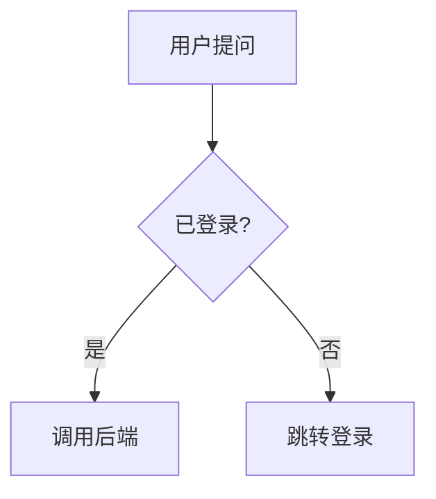
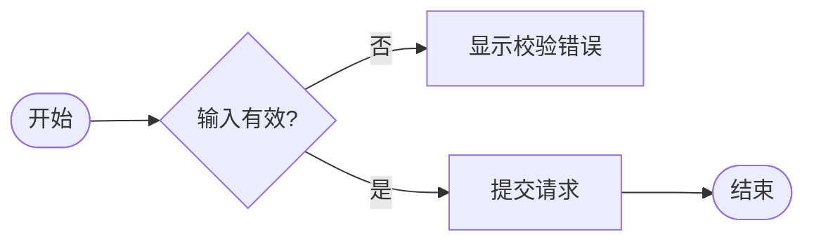
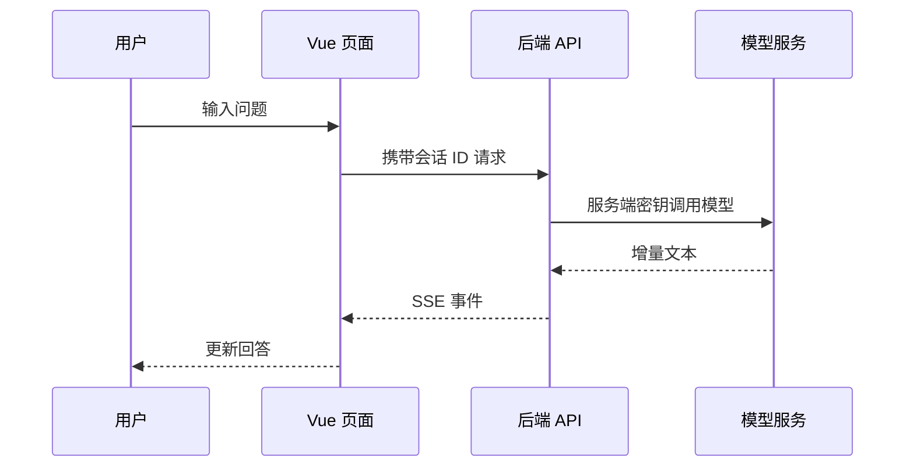
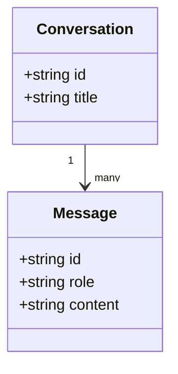

# 第 5 篇：Markdown 中的 Mermaid 图表：流程图、时序图、安全渲染与 Vue 生命周期

## 1. Mermaid 是什么

Mermaid 让作者通过文本描述图表，不需要在画布上手动拖拽节点。比如：

````markdown

````

Mermaid 会把这段文本解析成图表并生成 SVG。它与 Markdown 是两个独立解析器：markdown-it 识别代码围栏，Mermaid 理解其中的 `flowchart`、节点和连线语法。

## 2. 常见图类型

### 流程图



### 时序图



### 类图



先确认目标 Mermaid 版本支持图类型和语法。AI 可能生成旧版本不支持的新语法，图表区必须有错误回退。

## 3. 安装与初始化

```bash
npm install mermaid
```

Mermaid 是体积较大的绘图依赖，建议按需异步加载。它的全局初始化通常只做一次：

```js
let mermaidPromise

export function loadMermaid() {
  if (!mermaidPromise) {
    mermaidPromise = import('mermaid').then(({ default: mermaid }) => {
      mermaid.initialize({
        startOnLoad: false,
        securityLevel: 'strict',
        theme: 'default'
      })
      return mermaid
    })
  }

  return mermaidPromise
}
```

`startOnLoad: false` 表示由应用控制何时渲染，不让 Mermaid 在整个页面里自动扫描。`securityLevel: 'strict'` 会使用更严格的安全策略。主题应由页面主题状态决定；如果用户可以切换主题，需要重新渲染图表。

## 4. 让 markdown-it 识别 Mermaid 围栏

通过 fence renderer 把 Mermaid 源码放进一个安全容器，先不要直接把源码解释为 HTML：

```js
const defaultFence = md.renderer.rules.fence

md.renderer.rules.fence = (tokens, index, options, env, self) => {
  const token = tokens[index]
  const language = (token.info || '').trim().split(/\s+/)[0].toLowerCase()

  if (language !== 'mermaid') {
    return defaultFence
      ? defaultFence(tokens, index, options, env, self)
      : self.renderToken(tokens, index, options)
  }

  const source = md.utils.escapeHtml(token.content)
  return `<div class="mermaid-block" data-mermaid-source="">${source}</div>\n`
}
```

将源码作为文本节点输出，Vue 挂载后用 `element.textContent` 读取。不要把 Mermaid 源文拼进 HTML 属性；换行、引号和特殊字符都会造成转义错误。

## 5. 在 Vue 挂载后渲染

```js
import { nextTick, onBeforeUnmount, onMounted, watch } from 'vue'
import DOMPurify from 'dompurify'
import { loadMermaid } from '@/markdown/loadMermaid'

let renderVersion = 0
let mermaidId = 0

async function drawMermaid(container) {
  const currentVersion = ++renderVersion
  await nextTick()
  const mermaid = await loadMermaid()

  if (currentVersion !== renderVersion || !container.isConnected) return

  const nodes = container.querySelectorAll('.mermaid-block')
  for (const [index, node] of [...nodes].entries()) {
    const source = node.textContent || ''
    const id = `mermaid-${++mermaidId}-${index}`

    try {
      const result = await mermaid.render(id, source)
      if (currentVersion !== renderVersion || !node.isConnected) return
      node.innerHTML = DOMPurify.sanitize(result.svg, {
        USE_PROFILES: { svg: true }
      })
      result.bindFunctions?.(node)
    } catch {
      node.classList.add('mermaid-block--error')
      node.textContent = `图表语法无法解析\n${source}`
    }
  }
}
```

上面代码表达处理顺序：等 Vue 更新 DOM、异步加载库、给每个图唯一 ID、等待图表输出、在容器仍有效时写入 SVG、失败时保留源文。真实组件还要在卸载时使当前 `renderVersion` 失效，并在 `source` 更新后重新调用。

SVG 是 HTML 的一部分。只把 Mermaid 自己生成的 SVG 写入 DOM，并开启严格安全级别；不要把用户提供的 SVG 源码直接写入。示例中还对 Mermaid 生成结果使用 DOMPurify 的 SVG profile，再插入 DOM。文章正文仍使用 HTML profile 清理，两种 profile 不要合并成“允许任意 SVG”的宽松配置。若应用还允许 raw HTML，最终仍应统一 sanitizer，并确认 SVG 元素和属性策略。

## 6. 异步渲染和竞态

Mermaid 渲染是异步的。如果用户快速切换消息或切换主题，旧图可能在新内容之后返回，覆盖新图。可以使用递增版本号、AbortController（若当前 API 支持）或组件实例 token 忽略过期结果。

每次重新渲染前要清理旧 SVG，避免同一节点重复插入。示例用递增的 `renderVersion` 忽略较早任务，`mermaidId` 为每个图生成不同 ID；组件卸载时还应递增 `renderVersion` 让未完成任务失效，组件监听 `source` 和主题变化后再触发新一轮绘图。

## 7. 失败时保留源文本

图表语法错误不应该让整条消息消失。建议展示：

- “图表暂时无法绘制”的明确状态。
- 可展开或可复制的 Mermaid 源码。
- 错误详情仅在开发环境或点击后显示，避免把堆栈塞给普通用户。
- 重试按钮仅在加载失败而非语法错误时出现。

AI 输出时很容易出现未闭合大括号或尚未完成的节点。流式阶段可以先将 Mermaid fence 显示成普通代码，等消息完成后再尝试渲染。

## 8. 缩放和移动端布局

SVG 通常携带宽高信息。使用 CSS 限制最大宽度：

```css
.markdown-content :deep(.mermaid-block svg) {
  display: block;
  max-width: 100%;
  height: auto;
  margin-inline: auto;
}

.markdown-content :deep(.mermaid-block) {
  overflow: auto;
  max-width: 100%;
}
```

复杂图表可能需要容器内滚动或缩放控制，不要把固定宽度 SVG 撑出视口。深色主题应检查节点文字、连线和背景是否有足够对比度。

## 本篇验收清单

- 普通代码围栏仍由代码高亮规则处理。
- Mermaid 源文不会作为 HTML 直接执行。
- 每个图表都有唯一 ID，异步结果不会覆盖新内容。
- 组件卸载后不会向旧 DOM 写入。
- 语法失败时保留可复制源文。
- 深色主题、窄屏和超宽图都有可读的布局。
- 流式期间未闭合图表不会反复触发昂贵渲染。

## 官方资料

- [Mermaid 文档](https://mermaid.js.org/intro/)
- [Mermaid 安全配置](https://mermaid.js.org/config/usage.html)
- [Mermaid API](https://mermaid.js.org/config/setup/mermaid/interfaces/Mermaid.html)

## 系列导航

[上一篇：代码块与语法高亮](/articles/markdown-it-code-highlight-highlightjs-shiki) · [下一篇：数学公式与 KaTeX](/articles/markdown-it-math-katex-formulas)
