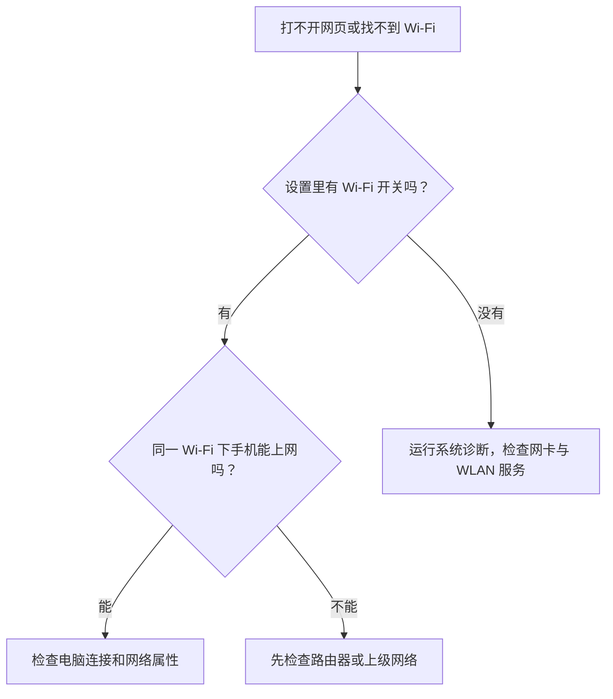

# 第 1 篇：Windows Wi‑Fi 图标消失修复

**适用环境**　以 Windows 11 为主。Windows 10 的路径单独标注。适合 Wi‑Fi 开关或可用网络列表消失的情况。若 Wi‑Fi 还能连上，只是网页打不开，先做同网设备对照。

## 先用两分钟判断问题在哪

| 看到的现象 | 先做什么 | 恢复后看到什么 |
| --- | --- | --- |
| 飞行模式亮着，或 Wi‑Fi 关了 | 按 `Win + A`，关闭飞行模式，再打开 Wi‑Fi。笔记本有实体无线开关时一并检查 | 能看到附近网络，并能重新连接 |
| 知道网络名却只在这台电脑上找不到 | 用手机连同一 Wi‑Fi，先关手机移动数据再打开网页。电脑尝试另一个已知可用的网络 | 能看出故障跟着电脑还是跟着家里网络 |
| 电脑、手机在同一 Wi‑Fi 上都打不开网页 | 按设备说明重启自己管理的路由器，等指示灯恢复后再试 | 两台设备重新联网 |
| 快捷设置没有 Wi‑Fi，系统设置里也没有 | 继续检查无线网卡和 WLAN 服务 | 设置中重新出现 Wi‑Fi 开关 |

每做一步便重新打开「设置 → 网络和 Internet」，连接已知可用的网络，再打开两个平时能访问的网站。恢复后可停止排查。

## Windows 11 先运行系统故障排查

1. 在开始菜单搜索并打开「获取帮助」。
2. 搜索「网络和 Internet 疑难解答」，按提示运行诊断。
3. 记录诊断提示和修复结果，再回到设置检查 Wi‑Fi。

Windows 10 可打开「设置 → 网络和 Internet → 状态 → 网络疑难解答」。Windows 10 的常规支持已于 2025 年 10 月 14 日结束。 [Microsoft：Wi‑Fi 故障排查](https://support.microsoft.com/en-us/windows/experience/connectivity-networking/fix-wi-fi-connection-issues-in-windows) · [Microsoft：Windows 10 支持结束](https://support.microsoft.com/windows/windows-10-support-ends-on-october-14-2025-2ca8b313-1946-43d3-b55c-2b95b107f281)

## 找不到 Wi‑Fi 开关时检查网卡和 WLAN 服务

### 看看系统能否识别无线网卡

右键开始按钮，打开「设备管理器 → 网络适配器」。无线网卡的名称通常含有 `Wi-Fi`、`Wireless` 或 `WLAN`。

- 如果右键菜单有「启用设备」，先启用，再检查设置。
- 如果有黄色感叹号，打开「属性 → 常规」记录错误代码。到电脑厂商支持页，按电脑型号和 Windows 版本找无线网卡驱动。断网时可以用网线联网，或用另一台设备下载官方驱动。
- 如果完全看不到无线网卡，在设备管理器选择「操作 → 扫描检测硬件改动」。仍无结果时，用电脑型号、故障开始时间和设备管理器的结果联系厂商或 IT。

### 检查 WLAN AutoConfig

1. 按 `Win + R`，输入 `services.msc` 并回车。
2. 找到 **WLAN AutoConfig**（WLAN 自动配置）。服务名是 `WlanSvc`。
3. 服务处于停止状态时，可右键「启动」。如果它已经在运行，可以尝试「重新启动」。
4. 回到快捷设置检查 Wi‑Fi。如果提示权限不足或服务启动失败，记录完整错误。公司电脑由 IT 检查服务策略。个人电脑可继续按驱动和系统故障方向排查。

曾有一台笔记本在手动启动 WLAN 服务后恢复，重启又复现，后来修复了网络配置。这一现象可以帮助定位故障范围。用正常重启后服务状态、网卡状态以及能否连网来判断修复结果。 [Microsoft：Wi‑Fi 故障排查](https://support.microsoft.com/en-us/windows/experience/connectivity-networking/fix-wi-fi-connection-issues-in-windows)

## Wi‑Fi 能连上，网页还是打不开

先忘记并重新连接自己的网络。Windows 11 打开「设置 → 网络和 Internet → Wi‑Fi → 管理已知网络」，找到网络后选择「忘记」。重新连接需要 Wi‑Fi 密码。

如果同一网络上的手机可以联网，电脑却仍打不开多个网站，可先查看电脑有没有拿到 IP、网关和 DNS。遇到网卡显示正常、服务能启动，但系统诊断提示网络配置异常时，再按微软文档逐条运行对应命令。记录「拒绝访问」等错误，便于判断命令执行到哪一步。 [Windows IP、DNS、网关速查](/console/article-directory/articles/windows-ip-dns-dhcp-fd5c357b) · [Microsoft：Wi‑Fi 诊断命令](https://support.microsoft.com/en-us/windows/experience/connectivity-networking/fix-wi-fi-connection-issues-in-windows)

## 最后再考虑在设置中执行网络重置

- Windows 11：「设置 → 网络和 Internet → 高级网络设置 → 网络重置」。
- Windows 10：「设置 → 网络和 Internet → 状态 → 网络重置」。

重置会移除并重新安装网络适配器，恢复默认网络配置。提前准备 Wi‑Fi 密码，记录自己设置的固定 IP、DNS，以及 VPN 或虚拟交换机配置。公司或校园管理的电脑，请 IT 确认后处理。重启后先连 Wi‑Fi、打开网页，再按需要恢复各项配置。 [Microsoft：网络重置及影响](https://support.microsoft.com/en-us/windows/experience/connectivity-networking/fix-wi-fi-connection-issues-in-windows)

如果系统同时出现其他故障，且有证据怀疑系统文件损坏，微软的系统文件检查流程是先运行 DISM，再运行 SFC。仅 Wi‑Fi 图标消失时，先用本页前面的步骤定位，并保留错误代码。 [Microsoft：系统文件检查器](https://support.microsoft.com/en-us/windows/experience/backup-recovery/using-system-file-checker-in-windows)

## 两分钟练习

在当前联网正常时，打开 `Win + A` 和「设置 → 网络和 Internet → Wi‑Fi」，找到当前网络和信号图标。打开设备管理器，记下无线网卡名称。下次遇到图标消失时，先记录「设置有没有 Wi‑Fi」「设备管理器有没有网卡」「手机连同一 Wi‑Fi 能不能联网」，再选择上面的分支。
