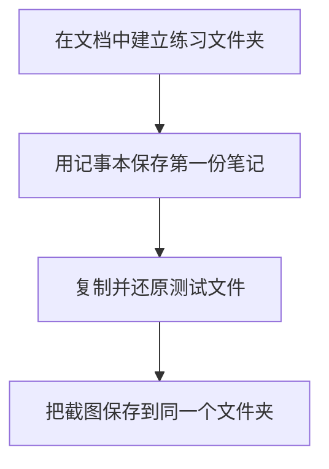

# 第 2 篇：Windows 电脑基础概念入门：开始菜单、任务栏、资源管理器、设置、终端

第一次用电脑，可以从做完一件事开始。下面用约 15 分钟创建一个文件夹，保存一份笔记，再复制、还原和截图。只操作练习文件，普通用户就能完成。

**适用环境**　Windows 11 中文界面。按 `Win + R`，输入 `winver` 并按回车，可以查看 Windows 版本。Windows 10 也可练习基本文件操作，菜单名称和位置可能不同。Windows 10 的常规支持已于 2025 年 10 月 14 日结束，部分版本或已加入延长安全更新计划的设备另有支持期限。 [微软 Windows 10 支持说明](https://support.microsoft.com/en-us/windows/deployment/updates-lifecycle/windows-10-support-has-ended-on-october-14-2025)

[[toc]]

**操作流程示意**

## 先认识鼠标和键盘

- **单击**是按一下鼠标左键，用来选中文件或点按钮。**双击**是快速按两下左键，用来打开文件或文件夹。
- **右键**是按一下鼠标右键，用来打开操作菜单。Windows 11 文件菜单上方的图标也能执行剪切、复制、重命名和删除。把鼠标停在图标上可以看名称，旧式菜单入口在「显示更多选项」。
- **Win** 是键盘上有 Windows 标志的键，通常在空格键左边。组合键 `Win + E`表示按住 Win、按一下 E，再松开。**回车**即 Enter。 [微软 Windows 快捷键](https://support.microsoft.com/windows/keyboard-shortcuts-in-windows-dcc61a57-8ff0-cffe-9796-cb9706c75eec)

## 练习一　建文件夹并保存笔记

1. 按 `Win + E` 打开「文件资源管理器」，在左侧选「文档」。左侧没显示「文档」，可按 `Win + R`，输入 `shell:Personal` 并回车打开当前文档文件夹。
2. 按 `Ctrl + Shift + N` 新建文件夹，输入「电脑练习」后回车，再双击进入这个文件夹。顶部地址栏显示当前位置。若同名文件夹本来就存在，可改为「电脑练习-新建」，后续都使用这个名字。
3. 按 `Alt + D` 选中顶部地址栏里的路径，再按 `Ctrl + C` 复制。按 Win 打开开始菜单，输入「记事本」，点搜索结果打开。
4. 输入「今天我学会了保存文件」，按 `Ctrl + S` 打开新文件的保存窗口，也可从「文件」菜单选择「另存为」。点保存窗口顶部地址栏或按 `Alt + D`，按 `Ctrl + V` 粘贴刚才的路径，再按回车。
5. 在「文件名」填 `第一份笔记.txt`，点「保存」。回到资源管理器，可用 `Alt + Tab` 切换窗口。双击笔记，应能读到刚才输入的文字。

**检查结果**　文件夹里有一份可重新打开的笔记。后续编辑同一份文件可用 `Ctrl + S`。如果列表只显示「第一份笔记」，在 Windows 11 资源管理器选择「查看 → 显示 → 文件扩展名」，即可看到完整名称。 [微软文件资源管理器说明](https://support.microsoft.com/zh-cn/windows/experience/fileexplorer/file-explorer-in-windows)

## 练习二　复制、改名和还原文件

1. 单击选中「第一份笔记.txt」，按 `Ctrl + C`，再在同一文件夹按 `Ctrl + V`。列表应该多一份笔记副本。
2. 单击选中副本，按 `F2`，输入「笔记备份」。如果启用了显示扩展名，F2 通常只会选中名称部分，请保留末尾的 `.txt`。
3. 选中「笔记备份」，按 `Delete`。本练习使用本机「文档」目录下的测试副本。若系统提示「永久删除」，请取消，改用放在本地固定磁盘的练习文件。网络目录、某些 U 盘或同步目录的删除行为可能不同。
4. 按 `Win + D` 回桌面，双击「回收站」。桌面没有这个图标时，可按 `Win + R`，输入 `shell:RecycleBinFolder` 并回车。找到刚删除的「笔记备份」，右键选择「还原」。
5. 返回「电脑练习」文件夹，确认原件和备份都能打开。日常复制后可先去目标文件夹检查副本，再决定是否删除原件。要直接移动文件时，在源位置按 `Ctrl + X`，到目标位置按 `Ctrl + V`。

**检查结果**　还原后应看到两份笔记。日常删除文件后，可先到回收站确认能否还原。清空回收站前先确认里面的内容。 [微软文件资源管理器说明](https://support.microsoft.com/zh-cn/windows/experience/fileexplorer/file-explorer-in-windows)

## 练习三　截图并找到浏览器下载记录

1. 打开笔记窗口，按 `Win + Shift + S`。屏幕出现截图工具后，若当前模式不同，先选择「矩形」。按住鼠标左键拖一个框，再松开。
2. 点截图通知打开截图工具，点击「另存为」图标或按 `Ctrl + S`，将截图保存到「电脑练习」并起名「第一次截图」。没看到通知时，先看看「图片」下的「屏幕截图」文件夹。还可打开「画图」，按 `Ctrl + V` 粘贴刚才的截图，再用 `Ctrl + S` 保存。
3. 打开 Edge 或 Chrome，按 `Ctrl + J` 查看浏览器的下载记录。有下载记录时，找到该条目的文件夹图标或「在文件夹中显示」来定位实际文件。列表为空时，可在资源管理器左侧直接打开「下载」。浏览器可另设下载位置，历史条目指向的文件也可能已被移动或删除。

**检查结果**　回到练习文件夹后，能双击打开刚保存的截图。浏览器的「下载记录」指向实际文件，文件存放位置可用「在文件夹中显示」确认。 [微软截图工具说明](https://support.microsoft.com/windows/use-snipping-tool-to-capture-screenshots-00246869-1843-655f-f220-97299b865f6b) · [Chrome 快捷键](https://support.google.com/chrome/answer/157179)

## 现在需要去哪儿

| 你想做什么 | 从哪里打开 | 会看到什么 |
| --- | --- | --- |
| 打开软件，或重启电脑 | 点任务栏上的「开始」，搜索应用或点电源图标 | 应用搜索结果，或「睡眠」「关机」「重启」等选项 |
| 在已打开的窗口之间切换 | 点底部任务栏上的应用图标，或按 `Alt + Tab` | 已经打开的窗口 |
| 找文件、复制、看 U 盘 | 按 `Win + E` 打开资源管理器，在左侧看「此电脑」 | 磁盘、文件夹和文件 |
| 连接 Wi-Fi 或蓝牙，改显示或管理应用 | 按 `Win + I` 打开「设置」 | 「网络和 Internet」「蓝牙和设备」「系统」「应用」等分类 |
| 查看哪个软件无响应 | 按 `Ctrl + Shift + Esc` 打开任务管理器，再点「进程」 | 应用、后台进程、CPU、内存和磁盘占用 |
| 临时离开电脑 | 按 `Win + L` | 锁屏界面，重新登录即可回到原窗口 |

资源管理器上方的地址栏显示**当前位置**，右侧的搜索框用来查找**文件**。如果想找刚才的笔记，先打开「电脑练习」，再在搜索框输入文件名。看到相似的名称时，可右键选择「属性」，查看类型、位置和大小。

## 以后遇到问题再认识这些工具

| 工具 | 怎么打开 | 常见用途 |
| --- | --- | --- |
| 控制面板 | 在「开始」搜索「控制面板」 | 某些传统的硬件和程序设置 |
| 运行 | `Win + R` | 直接输入程序名称、路径或命令，比如 `winver` |
| Windows 终端 | 右键「开始」→「终端」 | 一个可打开 PowerShell、命令提示符等环境的窗口 |
| 服务 | 在「开始」搜索「服务」 | 查看无需打开窗口也能在后台运行的系统与应用组件 |
| 设备管理器 | 右键「开始」→「设备管理器」 | 查看网卡、显卡、声卡等硬件及驱动状态 |

刚接触终端时，可以先试一条只查看信息的命令，例如在终端输入 `ipconfig` 后回车，查看网络配置。安装、设备驱动和后台服务的变更可能需要管理员授权，操作入口和判断方式见 [管理员权限与 UAC](/console/article-directory/articles/windows-uac-9d17ce33)。

## 接下来按需要阅读

1. 学会辨认 `.txt`、`.pdf` 和 `.zip`，并调整打开方式。 [文件扩展名、隐藏文件与默认应用](/console/article-directory/articles/windows-7c8d9756)
2. 练习常用快捷键，学会区分单个软件卡住、黑屏和整机无响应。 [电脑卡死救急与常用快捷键](/console/article-directory/articles/windows-freeze-rescue-shortcuts)
3. 问题出现时再查存储和开机启动。 [C 盘空间清理](/console/article-directory/articles/windows-c-storage-sense-windows-old-4fcfcbe9) · [启动项与干净启动](/console/article-directory/articles/windows-msconfig-3392836b) · [C 盘系统文件夹](/console/article-directory/articles/windows-c-1552bf32)
